# GenOTT

Experimental local production studio that plans scenes and renders short cinematic videos with interchangeable model backends.

## Workflow

1. Define a script or shot prompt.
2. Compile scenes and model prompts.
3. Render shots with a configured backend.
4. Review and export the video.

## Getting started

Run `python3 genott.py --help` to inspect available commands. Model weights and GPU dependencies must be installed separately.

## License

Original code is licensed under AGPL-3.0-only. Third party files in `third_party/` retain their upstream licenses.
