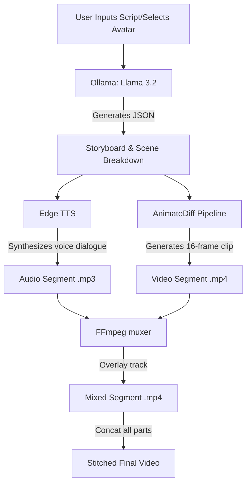

# GenOTT — Script to Cinema (Local Generative AI Movie Platform)

GenOTT is a local, free, generative OTT (Over-the-Top) video pipeline designed to run on consumer hardware (tested on NVIDIA RTX 4060 with 8GB VRAM). It breaks text scripts down into cinematic scenes, generates corresponding video prompts, synthesizes voice dialogue/narration, and renders short video segments that are stitched together into complete clips.

---

## 🎬 How GenOTT Works (Workflow)



1. **Script Planning**: The user writes a script or picks an avatar character (Tony Stark, Thor, Hulk).
2. **LLM breakdown**: A local LLM (**Llama 3.2** via Ollama) breaks the script down into a sequence of storyboard scenes, including visual descriptions, dialogues, and video generation prompts.
3. **Speech Synthesis**: For each scene dialogue, **Microsoft Edge TTS** generates high-fidelity voice narration.
4. **GPU Video Rendering**: The **AnimateDiff** pipeline renders 16-frame (~2 seconds at 8fps) video clips for each scene beat to fit within 8GB VRAM limits.
5. **A/V Stitching & Compilation**: **FFmpeg** mixes the voice audio track with each video clip, then losslessly concatenates all segments into a single cohesive final video with sound.

---

## 🛠️ Technology Stack & AI Models

| Layer | Technology | Details |
| :--- | :--- | :--- |
| **Backend** | Python / Flask | REST API endpoints for script generation, video pipeline, and log-polling. |
| **Frontend** | Vanilla CSS, HTML5, JavaScript | Interactive UI with real-time log terminal and video players. |
| **Database** | SQLite3 | Local database to persist saved movie projects. |
| **LLM (Text Generation)** | Ollama / Llama 3.2 | Free local model running on CPU/GPU to generate storyboards. |
| **Text-to-Video** | AnimateDiff + Motion Adapter | Dynamic frames generation offloaded to local GPU. |
| **Base Image Checkpoint** | epiCRealism | A highly realistic Stable Diffusion 1.5 model used by AnimateDiff. |
| **Voice / Audio (TTS)** | Microsoft Edge TTS | Free local TTS pipeline (via `edge-tts` python package). |
| **Video Processing** | FFmpeg | losslessly merges, muxes, and concatenates audio/video segments. |

---

## 📁 Project Directory Map

* **[app.py](file://PROJECT_ROOT/Documents/LLM/ott/genott-phase2/genott/app.py)**: The main Flask server containing endpoints `/api/generate`, `/api/generate-avatar-script`, `/api/generate-avatar-video`, and `/api/video-progress` to query progress logs.
* **[video_generator.py](file://PROJECT_ROOT/Documents/LLM/ott/genott-phase2/genott/video_generator.py)**: The core AI rendering module. Manages CUDA device offloading, loads `AnimateDiff`, processes progress logs, calls `Edge TTS`, and runs `FFmpeg` mixing and stitching.
* **[database.py](file://PROJECT_ROOT/Documents/LLM/ott/genott-phase2/genott/database.py)**: Handles SQLite table creation and saves/retrieves generated projects.
* **[templates/index.html](file://PROJECT_ROOT/Documents/LLM/ott/genott-phase2/genott/templates/index.html)**: The frontend web page layout. Contains selection cards, responsive styling, progress polling, and HTML5 video players.
* **[run.sh](file://PROJECT_ROOT/Documents/LLM/ott/genott-phase2/genott/run.sh)**: A bash runner script to launch Ollama and Flask servers in the background and redirect output to `project.log`.
* **[test_avatar.py](file://PROJECT_ROOT/Documents/LLM/ott/genott-phase2/genott/test_avatar.py)**: Standalone command-line testing script to run script generation and stitched avatar rendering from the CLI.
* **[ailog.txt](file://PROJECT_ROOT/Documents/LLM/ott/genott-phase2/genott/ailog.txt)**: Action logs tracking all feature implementations and bug fixes.
* **`static/videos/`**: Stores generated temporary video segments and compiled final cuts.
* **`venv/`**: Python virtual environment containing the installed modules (PyTorch, Diffusers, Accelerate, Edge-TTS).

---

## 🚀 Running and Testing

### 1. Launch all services
Run the main startup script:
```bash
./run.sh
```

### 2. Tail the aggregated log
Monitor the logs of all background processes in real-time:
```bash
tail -f project.log
```

### 3. CLI Direct Test
To render a 20-second stitched Tony Stark clip directly from the command line:
```bash
python3 test_avatar.py tony_stark
```

---

## 🧠 Training & Model Customization

Since the pipeline runs **locally and uses open-source standards**, you can train and swap models to change styles or improve quality:

### Swapping Checkpoints (Visual Style)
AnimateDiff runs on top of Stable Diffusion v1.5. If you want a different look (e.g. Cartoon, Anime, or CGI):
1. Download any `.safetensors` model checkpoint from Civitai (e.g. *ToonYou*, *DreamShaper*, or *Counterfeit*).
2. Change the checkpoint path loaded in `video_generator.py` (Line 50):
   ```python
   # Replace "emilianJR/epiCRealism" with your downloaded path or repo ID
   _pipeline = AnimateDiffPipeline.from_pretrained("your-new-checkpoint", ...)
   ```

### Custom Character Training (LoRA)
To train the AI to know exactly what a specific face/character looks like:
1. **Gather Images**: Collect 15–20 high-quality photos of the character from different angles.
2. **Train a LoRA**: Use tools like Kohya_ss or an online trainer (e.g. Civitai, Replicate) to train a **Stable Diffusion 1.5 LoRA** using a trigger word (e.g., `tonystark`).
3. **Load the LoRA**: Load the trained LoRA in `video_generator.py` after loading the pipeline:
   ```python
   _pipeline.load_lora_weights("path/to/character_lora.safetensors")
   ```
4. **Prompt Triggering**: Include the trigger word (`tonystark`) at the beginning of the video prompt.
